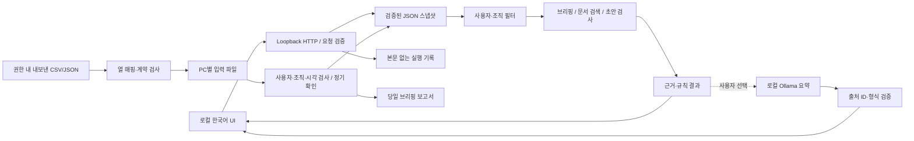

# 아키텍처와 조사 방법

## 현재 구현

Node.js 표준 라이브러리만 사용한다. UI는 프레임워크 없는 JavaScript와 CSS로 구성했다. 외부 CDN·폰트·텔레메트리를 로드하지 않는다. 동적 텍스트는 `textContent`로 표시하며 모델 응답의 HTML/Markdown을 실행하지 않는다.

| 파일 | 책임 |
|---|---|
| `src/schema.mjs` | 엄격한 데이터 계약, 날짜·URL 검증, 접근 범위 필터 |
| `src/demo.mjs` | 실제 기관과 무관한 합성 예제 생성 |
| `src/store.mjs` | 로컬 스냅샷 교체, 원자적 파일 교체, 직렬화된 감사 기록 |
| `src/tasks.mjs` | 결정적 브리핑·검색·초안 검증 |
| `src/model.mjs` | 선택형 로컬 모델 호출, 출력 스키마 및 근거 ID 확인 |
| `src/server.mjs` | loopback 바인딩, 요청 출처/CSRF/크기 검사, 작업 실행 |
| `src/automation.mjs` | 입력 파일 확인, 대상 사용자·조직 및 신선도 검사, KST 정기 보고서 |
| `src/csv.mjs` | UTF-8 CSV/TSV 파싱, 명시적 열 매핑과 데이터 계약 변환 |
| `scripts/` | 설치·진단·CSV 변환·수동 자동화 실행·Windows 업데이트와 로그인 실행 등록 |

## 적용한 REA 방법론

[REA](https://github.com/morluto/rea)의 근거·범위·미확인 사항을 분리하는 방식을 사용했다. 특정 그룹웨어의 공개 배포 자원에 정적 분석 도구를 적용해 화면 지연 로딩, 메뉴 식별자, 공통 요청 처리, 표·첨부·실시간 연결 후보를 조사했다. 이 결과는 운영 API 계약이나 재단의 실제 권한 검증을 대신하지 않는다.

공개 저장소에는 제품 JavaScript 원본, 내부 경로 목록, 기관별 조사 세부 내용, 인증 정보, 사용자 문서가 포함되지 않는다. 전체 조사 자료는 로컬 `analysis/`에 보관된다. 여기에는 재사용 가능한 방법론과 구현 구조만 정리한다.

## 신뢰 경계

1. 파일 안의 principal/ACL은 가져오기 작성자의 진술이다. 앱은 해당 진술을 일관되게 필터링하지만 상위 그룹웨어에서 진위를 검증하지 않는다.
2. 문서·공지·모델 응답은 신뢰할 수 없는 텍스트다. 모델은 도구 실행 권한을 갖지 않는다.
3. API는 범용 URL 요청 도구를 노출하지 않는다. `briefing`, `search`, `validate`만 실행한다.
4. CSRF와 Host/Origin 검사는 웹사이트로부터 로컬 서버를 보호하기 위한 방어다. 같은 OS 계정의 악성 프로세스나 로컬 파일 접근을 막는 사용자 인증 시스템은 아니다.
5. 가져오기 도중 작업 기준 revision이 바뀌면 오래된 작업 결과를 반환하지 않는다. 데이터 교체와 감사 기록은 하나의 직렬 큐에서 처리한다. DB 트랜잭션이나 다중 프로세스 쓰기는 지원하지 않는다.
6. AI가 오류·타임아웃·잘못된 출처를 반환하면 근거 기반 결과만 유지하고 기록에 부분 완료를 남긴다. JSON 형식과 ID 확인은 의미적 사실 검증이 아니다.
7. 실제 업무 시스템의 변경 작업은 구현되어 있지 않다. 로컬 데이터 교체는 화면에서 명시적으로 선택하거나, 사용자가 활성화한 파일 자동화 설정에 따라 실행한다.
8. 자동화는 설정된 파일만 읽는다. 웹 요청으로 임의 파일 경로를 지정할 수 없다. 파일의 사용자·조직이 설정과 일치해야 하며 자료 시각이 유효해야 한다. 보고서 제공 시 현재 스냅샷 해시·당일 날짜·자료 신선도·최근 실패 여부를 다시 확인한다.
9. GitHub에는 코드를 공유하고 PC별 설정·실제 자료·보고서는 제외한다. 서버는 단일 PC·단일 프로세스로 실행하며 공유 드라이브 동시 쓰기를 지원하지 않는다.

## 확장 방향

실제 커넥터는 검증된 사용자/조직·메뉴 권한을 조회해 동일한 정규화 계약을 생산하도록 설계한다. 원문 식별자·관찰 시각·버전·권한을 유지하고 문서 내용에서 실행 지시를 추출하지 않는다. 스냅샷의 최신성과 페이지 전체 수집 여부를 표시해야 한다.

자동화가 변경 단계로 확장되면 `제안 → 사용자 승인 → 실행 직전 재조회 → 변경 → 결과 확인` 상태 전이를 추가한다. 문서 버전 충돌, 중복 요청 키, 결과 유실 복구를 먼저 검증한다.
