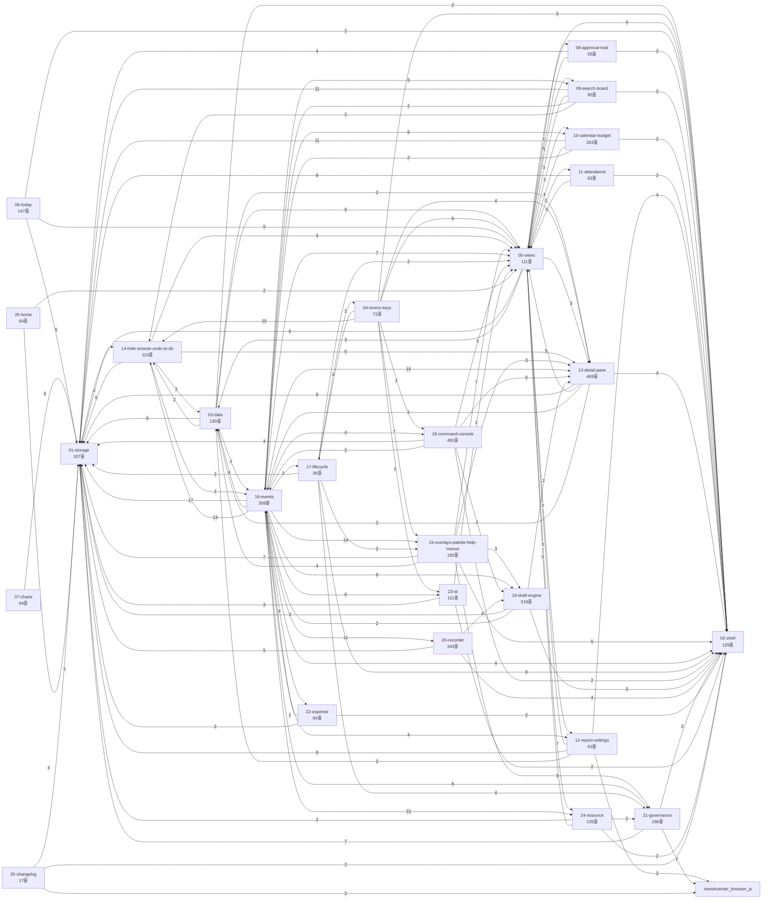

# 업무센터 코드 그래프

자동 생성: `npm run graph:write`. 직접 수정하지 마세요.

## 모듈 의존 (가중치 2 이상)

## 화면 이벤트 -> 처리 함수 (일부)

```mermaid
flowchart LR
  a_refresh(["refresh"])
  a_refresh --> f_refresh["refresh()"]
  a_applyRefresh(["applyRefresh"])
  a_applyRefresh --> f_render["render()"]
  a_close(["close"])
  a_close --> f_close["close()"]
  a_home(["home"])
  a_home --> f_goHome["goHome()"]
  a_apOpen(["apOpen"])
  a_apOpen --> f_findDoc["findDoc()"]
  a_apOpen --> f_leavePane["leavePane()"]
  a_apOpen --> f_renderMain["renderMain()"]
  a_copyErrors(["copyErrors"])
  a_copyErrors --> f_copyText["copyText()"]
  a_setTodayTab(["setTodayTab"])
  a_setTodayTab --> f_renderMain["renderMain()"]
  a_stateFilter(["stateFilter"])
  a_stateFilter --> f_renderMain["renderMain()"]
  a_rowMenu(["rowMenu"])
  a_rowMenu --> f_closeOverlay["closeOverlay()"]
  a_rowMenu --> f_openMenu["openMenu()"]
  a_markDone(["markDone"])
  a_markDone --> f_markDoneKeys["markDoneKeys()"]
  a_coach(["coach"])
  a_coach --> f_startCoach["startCoach()"]
  a_coachNext(["coachNext"])
  a_coachNext --> f_coachNext["coachNext()"]
  a_coachEnd(["coachEnd"])
  a_coachEnd --> f_endCoach["endCoach()"]
  a_openCmd(["openCmd"])
  a_openCmd --> f_openCommandConsole["openCommandConsole()"]
  a_openHistory(["openHistory"])
  a_openHistory --> f_openActionHistory["openActionHistory()"]
  a_submitCmd(["submitCmd"])
  a_submitCmd --> f_$["$()"]
  a_submitCmd --> f_executeCommandWorkflow["executeCommandWorkflow()"]
  a_runPreset(["runPreset"])
  a_runPreset --> f_executeCommandWorkflow["executeCommandWorkflow()"]
  a_clearHistory(["clearHistory"])
  a_clearHistory --> f_openActionHistory["openActionHistory()"]
  a_clearHistory --> f_toast["toast()"]
  a_mailToDraft(["mailToDraft"])
  a_mailToDraft --> f_mailToDraft["mailToDraft()"]
  a_quickDraft(["quickDraft"])
  a_quickDraft --> f_openResultPlanPicker["openResultPlanPicker()"]
  a_quickDraft --> f_autoStartDraft["autoStartDraft()"]
  a_openPay(["openPay"])
  a_openPay --> f_openPaymentHub["openPaymentHub()"]
  a_openChangelog(["openChangelog"])
  a_openChangelog --> f_openChangelog["openChangelog()"]
  a_goResource(["goResource"])
  a_goResource --> f_closeOverlay["closeOverlay()"]
  a_goResource --> f_go["go()"]
  a_resSel(["resSel"])
  a_resSel --> f_resSel["resSel()"]
  a_resDay(["resDay"])
  a_resDay --> f_resDay["resDay()"]
  a_resGo(["resGo"])
  a_resGo --> f_resGo["resGo()"]
  a_resFree(["resFree"])
  a_resFree --> f_resFree["resFree()"]
  a_resCheck(["resCheck"])
  a_resCheck --> f_resCheck["resCheck()"]
  a_resBook(["resBook"])
  a_resBook --> f_resBook["resBook()"]
  a_resCancelForm(["resCancelForm"])
  a_resCancelForm --> f_resCancelForm["resCancelForm()"]
  a_resReload(["resReload"])
  a_resReload --> f_resState["resState()"]
  a_resReload --> f_renderMain["renderMain()"]
  a_resReload --> f_resLoad["resLoad()"]
  a_openAi(["openAi"])
  a_openAi --> f_openAi["openAi()"]
  a_aiSetup(["aiSetup"])
  a_aiSetup --> f_aiSetup["aiSetup()"]
  a_aiSaveKey(["aiSaveKey"])
  a_aiSaveKey --> f_aiSaveKey["aiSaveKey()"]
  a_aiAsk(["aiAsk"])
  a_aiAsk --> f_aiAsk["aiAsk()"]
  a_aiForget(["aiForget"])
  a_aiForget --> f_aiForget["aiForget()"]
  a_aiClose(["aiClose"])
  a_aiClose --> f_aiClose["aiClose()"]
  a_expOpen(["expOpen"])
  a_expOpen --> f_expOpen["expOpen()"]
  a_expAdd(["expAdd"])
  a_expAdd --> f_expAdd["expAdd()"]
  a_expDel(["expDel"])
  a_expDel --> f_expDel["expDel()"]
```

## 규모

| 파일 | 줄 | 정의 |
|---|---|---|
| 01-storage.js | 107 | 32 |
| 02-shell.js | 129 | 13 |
| 03-data.js | 130 | 22 |
| 04-timers-keys.js | 73 | 5 |
| 05-views.js | 111 | 24 |
| 06-today.js | 147 | 6 |
| 07-charts.js | 64 | 7 |
| 08-approval-mail.js | 65 | 6 |
| 09-search-board.js | 85 | 14 |
| 10-calendar-budget.js | 263 | 21 |
| 11-attendance.js | 62 | 2 |
| 12-report-settings.js | 62 | 6 |
| 13-detail-pane.js | 469 | 30 |
| 14-hide-snooze-undo-to-do.js | 110 | 16 |
| 15-overlays-palette-help-menus.js | 182 | 20 |
| 16-events.js | 309 | 5 |
| 17-lifecycle.js | 36 | 7 |
| 18-command-console.js | 481 | 21 |
| 19-draft-engine.js | 516 | 42 |
| 20-recorder.js | 343 | 32 |
| 21-governance.js | 156 | 19 |
| 22-expense.js | 84 | 13 |
| 23-ai.js | 111 | 13 |
| 24-resource.js | 135 | 15 |
| 25-home.js | 64 | 2 |
| 26-changelog.js | 17 | 1 |
