# 업무센터 코드 그래프

자동 생성: `npm run graph:write`. 직접 수정하지 마세요.

## 모듈 의존 (가중치 2 이상)

```mermaid
flowchart LR
  m01_storage_js["01-storage<br/>325줄"]
  m02_shell_js["02-shell<br/>162줄"]
  m03_data_js["03-data<br/>175줄"]
  m04_timers_keys_js["04-timers-keys<br/>100줄"]
  m05_views_js["05-views<br/>152줄"]
  m06_today_js["06-today<br/>90줄"]
  m07_charts_js["07-charts<br/>75줄"]
  m08_approval_mail_js["08-approval-mail<br/>128줄"]
  m09_search_board_js["09-search-board<br/>168줄"]
  m10_calendar_budget_js["10-calendar-budget<br/>332줄"]
  m11_attendance_js["11-attendance<br/>76줄"]
  m12_report_settings_js["12-report-settings<br/>162줄"]
  m13_detail_pane_js["13-detail-pane<br/>661줄"]
  m14_hide_snooze_undo_to_do_js["14-hide-snooze-undo-to-do<br/>129줄"]
  m15_overlays_palette_help_menus_js["15-overlays-palette-help-menus<br/>257줄"]
  m16_events_js["16-events<br/>421줄"]
  m17_lifecycle_js["17-lifecycle<br/>42줄"]
  m18_command_console_js["18-command-console<br/>446줄"]
  m19_draft_engine_js["19-draft-engine<br/>653줄"]
  m20_recorder_js["20-recorder<br/>365줄"]
  m21_governance_js["21-governance<br/>284줄"]
  m22_expense_js["22-expense<br/>88줄"]
  m23_ai_js["23-ai<br/>127줄"]
  m24_resource_js["24-resource<br/>146줄"]
  m25_home_js["25-home<br/>21줄"]
  m26_changelog_js["26-changelog<br/>17줄"]
  m27_attendance_request_js["27-attendance-request<br/>250줄"]
  m28_gcal_js["28-gcal<br/>76줄"]
  m29_home_view_js["29-home-view<br/>179줄"]
  m30_chat_ui_js["30-chat-ui<br/>185줄"]
  m31_chat_engine_js["31-chat-engine<br/>392줄"]
  m32_chat_tools_read_js["32-chat-tools-read<br/>418줄"]
  m33_chat_tools_act_js["33-chat-tools-act<br/>221줄"]
  m34_gsync_js["34-gsync<br/>107줄"]
  m35_docs_js["35-docs<br/>127줄"]
  m36_chat_tools_more_js["36-chat-tools-more<br/>329줄"]
  m37_automation_js["37-automation<br/>177줄"]
  m38_notifications_people_js["38-notifications-people<br/>159줄"]
  m39_motion_js["39-motion<br/>92줄"]
  m40_usage_js["40-usage<br/>53줄"]
  m01_storage_js -->|2| m14_hide_snooze_undo_to_do_js
  m01_storage_js -->|3| m03_data_js
  m03_data_js -->|9| m01_storage_js
  m03_data_js -->|2| m16_events_js
  m03_data_js -->|5| m05_views_js
  m03_data_js -->|2| m02_shell_js
  m03_data_js -->|2| m38_notifications_people_js
  m03_data_js -->|2| m14_hide_snooze_undo_to_do_js
  m03_data_js -->|2| m13_detail_pane_js
  m04_timers_keys_js -->|2| m17_lifecycle_js
  m04_timers_keys_js -->|3| m02_shell_js
  m04_timers_keys_js -->|7| m15_overlays_palette_help_menus_js
  m04_timers_keys_js -->|10| m14_hide_snooze_undo_to_do_js
  m04_timers_keys_js -->|4| m13_detail_pane_js
  m04_timers_keys_js -->|7| m05_views_js
  m04_timers_keys_js -->|3| m38_notifications_people_js
  m04_timers_keys_js -->|2| m10_calendar_budget_js
  m04_timers_keys_js -->|2| m09_search_board_js
  m04_timers_keys_js -->|2| m23_ai_js
  m05_views_js -->|7| m01_storage_js
  m05_views_js -->|5| m02_shell_js
  m05_views_js -->|2| m21_governance_js
  m05_views_js -->|3| m13_detail_pane_js
  m05_views_js -->|2| m06_today_js
  m05_views_js -->|2| mworkcenter_browser_js
  m05_views_js -->|6| m09_search_board_js
  m05_views_js -->|2| m29_home_view_js
  m05_views_js -->|4| m38_notifications_people_js
  m05_views_js -->|2| m08_approval_mail_js
  m05_views_js -->|4| m10_calendar_budget_js
  m05_views_js -->|2| m11_attendance_js
  m05_views_js -->|3| m24_resource_js
  m05_views_js -->|2| m12_report_settings_js
  m05_views_js -->|3| m03_data_js
  m06_today_js -->|10| m05_views_js
  m06_today_js -->|5| m01_storage_js
  m06_today_js -->|2| m02_shell_js
  m07_charts_js -->|6| m01_storage_js
  m08_approval_mail_js -->|7| m01_storage_js
  m08_approval_mail_js -->|5| m05_views_js
  m08_approval_mail_js -->|2| m02_shell_js
  m09_search_board_js -->|3| m02_shell_js
  m09_search_board_js -->|10| m01_storage_js
  m09_search_board_js -->|5| m05_views_js
  m09_search_board_js -->|2| m16_events_js
  m09_search_board_js -->|4| m14_hide_snooze_undo_to_do_js
  m10_calendar_budget_js -->|12| m01_storage_js
  m10_calendar_budget_js -->|2| m02_shell_js
  m10_calendar_budget_js -->|5| m05_views_js
  m10_calendar_budget_js -->|2| m16_events_js
  m11_attendance_js -->|8| m01_storage_js
  m11_attendance_js -->|2| m02_shell_js
  m11_attendance_js -->|3| m10_calendar_budget_js
  m11_attendance_js -->|2| m05_views_js
  m12_report_settings_js -->|4| m02_shell_js
  m12_report_settings_js -->|8| m05_views_js
  m12_report_settings_js -->|11| m01_storage_js
  m12_report_settings_js -->|3| m16_events_js
  m12_report_settings_js -->|2| m03_data_js
  m12_report_settings_js -->|2| m21_governance_js
  m12_report_settings_js -->|2| mworkcenter_browser_js
  m12_report_settings_js -->|2| m04_timers_keys_js
  m12_report_settings_js -->|2| m14_hide_snooze_undo_to_do_js
  m13_detail_pane_js -->|4| m02_shell_js
  m13_detail_pane_js -->|10| m01_storage_js
  m13_detail_pane_js -->|6| m05_views_js
  m13_detail_pane_js -->|2| m16_events_js
  m13_detail_pane_js -->|2| m17_lifecycle_js
  m13_detail_pane_js -->|4| m03_data_js
  m13_detail_pane_js -->|4| m10_calendar_budget_js
  m13_detail_pane_js -->|4| m19_draft_engine_js
  m14_hide_snooze_undo_to_do_js -->|6| m01_storage_js
  m14_hide_snooze_undo_to_do_js -->|3| m03_data_js
  m14_hide_snooze_undo_to_do_js -->|2| m16_events_js
  m14_hide_snooze_undo_to_do_js -->|4| m05_views_js
  m14_hide_snooze_undo_to_do_js -->|6| m13_detail_pane_js
  m15_overlays_palette_help_menus_js -->|5| m02_shell_js
  m15_overlays_palette_help_menus_js -->|8| m01_storage_js
  m15_overlays_palette_help_menus_js -->|7| m05_views_js
  m15_overlays_palette_help_menus_js -->|5| m03_data_js
  m15_overlays_palette_help_menus_js -->|2| m13_detail_pane_js
  m15_overlays_palette_help_menus_js -->|2| mworkcenter_browser_js
  m15_overlays_palette_help_menus_js -->|3| m19_draft_engine_js
  m15_overlays_palette_help_menus_js -->|3| m21_governance_js
  m16_events_js -->|4| m02_shell_js
  m16_events_js -->|10| m19_draft_engine_js
  m16_events_js -->|12| m20_recorder_js
  m16_events_js -->|21| m01_storage_js
  m16_events_js -->|15| m15_overlays_palette_help_menus_js
  m16_events_js -->|2| m40_usage_js
  m16_events_js -->|7| m03_data_js
  m16_events_js -->|7| m05_views_js
  m16_events_js -->|18| m13_detail_pane_js
  m16_events_js -->|2| m17_lifecycle_js
  m16_events_js -->|14| m14_hide_snooze_undo_to_do_js
  m16_events_js -->|5| m18_command_console_js
  m16_events_js -->|3| m28_gcal_js
  m16_events_js -->|10| m24_resource_js
  m16_events_js -->|7| m23_ai_js
  m16_events_js -->|6| m22_expense_js
  m16_events_js -->|9| m21_governance_js
  m16_events_js -->|9| m12_report_settings_js
  m16_events_js -->|8| m09_search_board_js
  m16_events_js -->|11| m38_notifications_people_js
  m16_events_js -->|9| m10_calendar_budget_js
  m16_events_js -->|2| m06_today_js
  m16_events_js -->|4| m35_docs_js
  m17_lifecycle_js -->|2| m03_data_js
  m17_lifecycle_js -->|8| m02_shell_js
  m17_lifecycle_js -->|3| m01_storage_js
  m17_lifecycle_js -->|2| m15_overlays_palette_help_menus_js
  m17_lifecycle_js -->|4| m05_views_js
  m17_lifecycle_js -->|7| m21_governance_js
  m17_lifecycle_js -->|3| m04_timers_keys_js
  m17_lifecycle_js -->|2| m37_automation_js
  m18_command_console_js -->|2| m02_shell_js
  m18_command_console_js -->|5| m01_storage_js
  m18_command_console_js -->|3| m05_views_js
  m18_command_console_js -->|2| m16_events_js
  m18_command_console_js -->|7| m13_detail_pane_js
  m18_command_console_js -->|2| m19_draft_engine_js
  m19_draft_engine_js -->|5| m01_storage_js
  m19_draft_engine_js -->|3| m02_shell_js
  m19_draft_engine_js -->|2| m16_events_js
  m19_draft_engine_js -->|3| m15_overlays_palette_help_menus_js
  m19_draft_engine_js -->|3| m13_detail_pane_js
  m20_recorder_js -->|4| m02_shell_js
  m20_recorder_js -->|4| m19_draft_engine_js
  m20_recorder_js -->|5| m01_storage_js
  m20_recorder_js -->|2| m15_overlays_palette_help_menus_js
  m21_governance_js -->|4| m02_shell_js
  m21_governance_js -->|9| m01_storage_js
  m21_governance_js -->|2| m13_detail_pane_js
  m21_governance_js -->|2| mworkcenter_browser_js
  m21_governance_js -->|2| m05_views_js
  m22_expense_js -->|2| m02_shell_js
  m22_expense_js -->|2| m16_events_js
  m22_expense_js -->|2| m01_storage_js
  m23_ai_js -->|3| m21_governance_js
  m23_ai_js -->|4| m01_storage_js
  m23_ai_js -->|2| m02_shell_js
  m23_ai_js -->|2| m05_views_js
  m24_resource_js -->|3| m01_storage_js
  m24_resource_js -->|2| m02_shell_js
  m24_resource_js -->|2| m21_governance_js
  m24_resource_js -->|2| m05_views_js
  m26_changelog_js -->|3| m01_storage_js
  m26_changelog_js -->|2| mworkcenter_browser_js
  m26_changelog_js -->|2| m02_shell_js
  m27_attendance_request_js -->|2| m18_command_console_js
  m27_attendance_request_js -->|3| m01_storage_js
  m27_attendance_request_js -->|2| m02_shell_js
  m27_attendance_request_js -->|4| m19_draft_engine_js
  m27_attendance_request_js -->|3| m13_detail_pane_js
  m28_gcal_js -->|3| m01_storage_js
  m28_gcal_js -->|2| m02_shell_js
  m28_gcal_js -->|2| m16_events_js
  m28_gcal_js -->|2| m05_views_js
  m29_home_view_js -->|5| m01_storage_js
  m29_home_view_js -->|4| m02_shell_js
  m29_home_view_js -->|8| m05_views_js
  m29_home_view_js -->|3| m10_calendar_budget_js
  m29_home_view_js -->|2| m30_chat_ui_js
  m30_chat_ui_js -->|3| m01_storage_js
  m30_chat_ui_js -->|3| m02_shell_js
  m30_chat_ui_js -->|3| m29_home_view_js
  m30_chat_ui_js -->|4| m05_views_js
  m30_chat_ui_js -->|8| m31_chat_engine_js
  m30_chat_ui_js -->|2| m16_events_js
  m30_chat_ui_js -->|2| m13_detail_pane_js
  m31_chat_engine_js -->|3| m01_storage_js
  m31_chat_engine_js -->|2| m30_chat_ui_js
  m31_chat_engine_js -->|4| m23_ai_js
  m31_chat_engine_js -->|2| m05_views_js
  m31_chat_engine_js -->|2| m16_events_js
  m32_chat_tools_read_js -->|7| m01_storage_js
  m32_chat_tools_read_js -->|7| m05_views_js
  m32_chat_tools_read_js -->|3| m10_calendar_budget_js
  m32_chat_tools_read_js -->|3| m31_chat_engine_js
  m32_chat_tools_read_js -->|2| m21_governance_js
  m32_chat_tools_read_js -->|2| m13_detail_pane_js
  m32_chat_tools_read_js -->|4| m18_command_console_js
  m32_chat_tools_read_js -->|2| m34_gsync_js
  m33_chat_tools_act_js -->|4| m01_storage_js
  m33_chat_tools_act_js -->|4| m32_chat_tools_read_js
  m33_chat_tools_act_js -->|4| m18_command_console_js
  m33_chat_tools_act_js -->|4| m05_views_js
  m34_gsync_js -->|5| m01_storage_js
  m34_gsync_js -->|2| m28_gcal_js
  m34_gsync_js -->|4| m05_views_js
  m34_gsync_js -->|2| m02_shell_js
  m35_docs_js -->|6| m01_storage_js
  m35_docs_js -->|3| m05_views_js
  m35_docs_js -->|2| m02_shell_js
  m35_docs_js -->|2| m13_detail_pane_js
  m36_chat_tools_more_js -->|7| m01_storage_js
  m36_chat_tools_more_js -->|4| m32_chat_tools_read_js
  m36_chat_tools_more_js -->|2| m31_chat_engine_js
  m36_chat_tools_more_js -->|4| m05_views_js
  m36_chat_tools_more_js -->|2| m03_data_js
  m36_chat_tools_more_js -->|2| m14_hide_snooze_undo_to_do_js
  m37_automation_js -->|5| m01_storage_js
  m37_automation_js -->|5| m31_chat_engine_js
  m37_automation_js -->|2| m02_shell_js
  m37_automation_js -->|2| m29_home_view_js
  m37_automation_js -->|2| m03_data_js
  m38_notifications_people_js -->|4| m01_storage_js
  m38_notifications_people_js -->|2| m05_views_js
  m38_notifications_people_js -->|2| m02_shell_js
  m39_motion_js -->|3| m02_shell_js
  m40_usage_js -->|6| m01_storage_js
  m40_usage_js -->|2| m02_shell_js
```

## 화면 이벤트 -> 처리 함수 (일부)

```mermaid
flowchart LR
  a_skipMain(["skipMain"])
  a_skipMain --> f_$["$()"]
  a_refresh(["refresh"])
  a_refresh --> f_refresh["refresh()"]
  a_applyRefresh(["applyRefresh"])
  a_applyRefresh --> f_applyDeferredBudgetInvalidation["applyDeferredBudgetInvalidation()"]
  a_applyRefresh --> f_render["render()"]
  a_close(["close"])
  a_close --> f_close["close()"]
  a_home(["home"])
  a_home --> f_goHome["goHome()"]
  a_apOpen(["apOpen"])
  a_apOpen --> f_findDoc["findDoc()"]
  a_apOpen --> f_leavePane["leavePane()"]
  a_apOpen --> f_renderMain["renderMain()"]
  a_copyErrors(["copyErrors"])
  a_copyErrors --> f_copyText["copyText()"]
  a_setTodayTab(["setTodayTab"])
  a_setTodayTab --> f_renderMain["renderMain()"]
  a_stateFilter(["stateFilter"])
  a_stateFilter --> f_renderMain["renderMain()"]
  a_rowMenu(["rowMenu"])
  a_rowMenu --> f_closeOverlay["closeOverlay()"]
  a_rowMenu --> f_openMenu["openMenu()"]
  a_markDone(["markDone"])
  a_markDone --> f_markDoneKeys["markDoneKeys()"]
  a_coach(["coach"])
  a_coach --> f_startCoach["startCoach()"]
  a_coachNext(["coachNext"])
  a_coachNext --> f_coachNext["coachNext()"]
  a_coachEnd(["coachEnd"])
  a_coachEnd --> f_endCoach["endCoach()"]
  a_openCmd(["openCmd"])
  a_openCmd --> f_openCommandConsole["openCommandConsole()"]
  a_openChatHome(["openChatHome"])
  a_openChatHome --> f_closeOverlay["closeOverlay()"]
  a_openHistory(["openHistory"])
  a_openHistory --> f_openActionHistory["openActionHistory()"]
  a_submitCmd(["submitCmd"])
  a_submitCmd --> f_$["$()"]
  a_submitCmd --> f_executeCommandWorkflow["executeCommandWorkflow()"]
  a_runPreset(["runPreset"])
  a_runPreset --> f_executeCommandWorkflow["executeCommandWorkflow()"]
  a_recoverWeekly(["recoverWeekly"])
  a_recoverWeekly --> f_saveLocal["saveLocal()"]
  a_recoverWeekly --> f_toast["toast()"]
  a_recoverWeekly --> f_renderMain["renderMain()"]
  a_clearHistory(["clearHistory"])
  a_clearHistory --> f_logActionRecord["logActionRecord()"]
  a_clearHistory --> f_openActionHistory["openActionHistory()"]
  a_clearHistory --> f_toast["toast()"]
  a_mailToDraft(["mailToDraft"])
  a_mailToDraft --> f_mailToDraft["mailToDraft()"]
  a_quickDraft(["quickDraft"])
  a_quickDraft --> f_openResultPlanPicker["openResultPlanPicker()"]
  a_quickDraft --> f_autoStartDraft["autoStartDraft()"]
  a_openPay(["openPay"])
  a_openPay --> f_openPaymentHub["openPaymentHub()"]
  a_openChangelog(["openChangelog"])
  a_openChangelog --> f_openChangelog["openChangelog()"]
  a_goResource(["goResource"])
  a_goResource --> f_closeOverlay["closeOverlay()"]
  a_goResource --> f_go["go()"]
  a_gcalMode(["gcalMode"])
  a_gcalMode --> f_gcalCfg["gcalCfg()"]
  a_gcalMode --> f_saveLocal["saveLocal()"]
  a_gcalMode --> f_renderMain["renderMain()"]
  a_gcalSave(["gcalSave"])
  a_gcalSave --> f_gcalSave["gcalSave()"]
  a_gcalCancel(["gcalCancel"])
  a_gcalCancel --> f_renderMain["renderMain()"]
  a_gcalEdit(["gcalEdit"])
  a_gcalEdit --> f_renderMain["renderMain()"]
  a_gcalNew(["gcalNew"])
  a_gcalNew --> f_gcalOpenTab["gcalOpenTab()"]
  a_gcalOpen(["gcalOpen"])
  a_gcalOpen --> f_gcalOpenTab["gcalOpenTab()"]
  a_gcalOpen --> f_gcalCfg["gcalCfg()"]
  a_resSel(["resSel"])
  a_resSel --> f_resSel["resSel()"]
  a_resDay(["resDay"])
  a_resDay --> f_resDay["resDay()"]
  a_resFree(["resFree"])
  a_resFree --> f_resFree["resFree()"]
  a_resCheck(["resCheck"])
  a_resCheck --> f_resCheck["resCheck()"]
  a_resBook(["resBook"])
  a_resBook --> f_resBook["resBook()"]
  a_resCancelForm(["resCancelForm"])
  a_resCancelForm --> f_resCancelForm["resCancelForm()"]
  a_resReload(["resReload"])
  a_resReload --> f_resState["resState()"]
  a_resReload --> f_renderMain["renderMain()"]
  a_resReload --> f_resLoad["resLoad()"]
  a_openAi(["openAi"])
  a_openAi --> f_openAi["openAi()"]
```

## 규모

| 파일 | 줄 | 정의 |
|---|---|---|
| 01-storage.js | 325 | 52 |
| 02-shell.js | 162 | 19 |
| 03-data.js | 175 | 25 |
| 04-timers-keys.js | 100 | 5 |
| 05-views.js | 152 | 28 |
| 06-today.js | 90 | 7 |
| 07-charts.js | 75 | 9 |
| 08-approval-mail.js | 128 | 12 |
| 09-search-board.js | 168 | 21 |
| 10-calendar-budget.js | 332 | 28 |
| 11-attendance.js | 76 | 2 |
| 12-report-settings.js | 162 | 15 |
| 13-detail-pane.js | 661 | 39 |
| 14-hide-snooze-undo-to-do.js | 129 | 16 |
| 15-overlays-palette-help-menus.js | 257 | 23 |
| 16-events.js | 421 | 6 |
| 17-lifecycle.js | 42 | 10 |
| 18-command-console.js | 446 | 20 |
| 19-draft-engine.js | 653 | 45 |
| 20-recorder.js | 365 | 33 |
| 21-governance.js | 284 | 32 |
| 22-expense.js | 88 | 13 |
| 23-ai.js | 127 | 16 |
| 24-resource.js | 146 | 15 |
| 25-home.js | 21 | 1 |
| 26-changelog.js | 17 | 1 |
| 27-attendance-request.js | 250 | 11 |
| 28-gcal.js | 76 | 12 |
| 29-home-view.js | 179 | 11 |
| 30-chat-ui.js | 185 | 26 |
| 31-chat-engine.js | 392 | 26 |
| 32-chat-tools-read.js | 418 | 9 |
| 33-chat-tools-act.js | 221 | 6 |
| 34-gsync.js | 107 | 14 |
| 35-docs.js | 127 | 13 |
| 36-chat-tools-more.js | 329 | 12 |
| 37-automation.js | 177 | 18 |
| 38-notifications-people.js | 159 | 26 |
| 39-motion.js | 92 | 16 |
| 40-usage.js | 53 | 7 |
